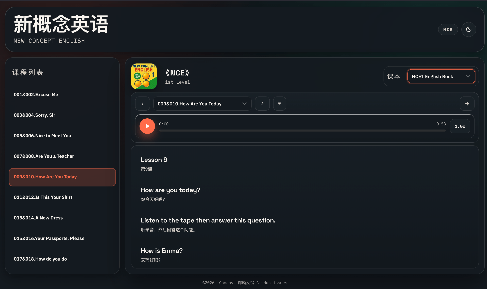

# 新概念英语 · 在线点读系统

[](https://wumacms.github.io/nce)
[](https://github.com/wumacms/nce/blob/main/LICENSE)

《New Concept English》全四册在线点读：课文朗读、单句点读、中英对照。

**在线体验**：<https://wumacms.github.io/nce>



## 功能

- 美音课文朗读，倍速 / 单句循环 / 逐句点读
- 中英对照歌词，实时高亮当前句
- 明暗主题，移动端适配
- 播放进度记忆，续读上次的课
- 纯静态部署，浏览器直接访问

## 四册概览

| 册 | 书名 | 课数 | 适合 |
|---|---|---|---|
| 1 | First Things First | 144 | 零基础，语音与语感 |
| 2 | Practice and Progress | 96 | 语法体系与听说读写 |
| 3 | Developing Skills | 60 | 进阶阅读与复杂句型 |
| 4 | Fluency in English | 48 | 高阶表达与学术阅读 |

## 技术栈

Vue 3 + Vite + TypeScript + Tailwind CSS 4，构建产物为纯静态站点。

```bash
pnpm install   # 安装依赖
pnpm dev       # 开发服务器 http://localhost:5173/nce/
pnpm build     # 类型检查 + 构建（自动生成各册 book.json）
pnpm preview   # 预览构建产物
```

## 外挂资源

播放器与资源解耦：一个课本 = 一个静态目录（`book.json` + mp3 + lrc）。

```json
// static/data.json
{ "books": [{ "key": "MYBOOK", "title": "My Book", "path": "https://your-host/your-book" }] }
```

- lrc 格式：`[mm:ss.xx]英文 | 中文`（中文可省略）
- 文件名中的空格、`&`、`,`、全角字符自动做 URL 编码
- 访问 `/#MYBOOK` 直达课本；远程资源需支持 CORS

## 说明

- 仅供个人学习研究，非商业用途
- 音频来自 [tangx/New-Concept-English](https://github.com/tangx/New-Concept-English)；中文字幕由 AI 生成，欢迎指正
- 版权归原作者所有，侵权请联系 issues，建议支持正版
